# 🌦️ Weather Forecast & Alert Application

> A Python weather dashboard and API that fetches forecasts from Open-Meteo, evaluates configurable weather thresholds, and produces reports and alerts. Includes offline simulation for testing and demonstrations.

---

## 👨‍💻 Author

**Adarsh Srivastav**
Computer Science and Engineering (CSE) Student

Python | API Integration | Data Visualization | Application Development

---

## 📌 Project Overview

The **Weather Forecast & Alert Application** retrieves current weather and forecast data for a selected city, checks the data against simple alert rules, and presents the results in a dashboard, command-line report, or REST API response.

The application uses the public **Open-Meteo Geocoding and Forecast APIs** for live data. It also includes a local sample payload so the project can be demonstrated and tested without network access or an API key.

The project is intended as an educational prototype and proof of work. Its rule-based alerts are not official weather warnings and should not be used as the sole source for safety-critical decisions.

---

## 🎯 Objectives

- Retrieve live weather forecasts by city.
- Support a self-contained offline simulation mode.
- Parse current, hourly, and daily weather values.
- Generate readable rain, heat, humidity, wind, and UV alerts.
- Visualize current conditions and forecasts in a Streamlit dashboard.
- Expose forecast and alert data through FastAPI.
- Save hourly forecasts as CSV and a summary as JSON.
- Demonstrate API integration, Python modularity, testing, and documentation.

---

## ✨ Key Features

- City lookup through Open-Meteo Geocoding.
- Live current conditions and a seven-day forecast.
- Simulation data that works offline and needs no API key.
- Threshold-based rain, heat, humidity, wind, and UV alerts.
- Streamlit dashboard with current-condition metrics and forecast charts.
- FastAPI endpoints for health, live weather, and simulation data.
- CSV and JSON report generation in `outputs/`.
- Unit tests for alert rules and simulation behavior.
- GitHub-ready documentation and screenshot evidence.

---

## 🏗️ System Architecture

```text
                         WEATHER FORECAST & ALERT APPLICATION
                                           │
                    ┌──────────────────────┴──────────────────────┐
                    │                                             │
                    ▼                                             ▼
             City entered by user                         Sample JSON file
                    │                                      (offline mode)
                    ▼                                             │
          Open-Meteo Geocoding API                                │
                    │                                             │
                    ▼                                             │
          Open-Meteo Forecast API                                 │
                    └──────────────────────┬──────────────────────┘
                                           ▼
                               Weather payload processing
                                           │
                    ┌──────────────────────┼──────────────────────┐
                    │                      │                      │
                    ▼                      ▼                      ▼
             Alert rule engine       CSV/JSON reports        FastAPI service
                    │                      │                      │
                    └──────────────────────┼──────────────────────┘
                                           ▼
                                Streamlit dashboard
```

### Application components

| Component | Responsibility |
|---|---|
| `src/weather.py` | Fetches live weather or loads the simulation payload |
| `src/rules.py` | Evaluates weather values against alert thresholds |
| `src/reports.py` | Builds forecast tables and writes CSV/JSON reports |
| `main.py` | Runs the command-line application |
| `app.py` | Provides the Streamlit dashboard |
| `api/app.py` | Exposes weather and alert data through FastAPI |
| `data/sample_weather.json` | Provides deterministic offline demonstration data |

---

## 🔄 Working Principle

```text
Enter a city or choose simulation
              ↓
Fetch Open-Meteo data or load sample JSON
              ↓
Read current, hourly, and daily values
              ↓
Evaluate configured alert thresholds
              ↓
Display dashboard, CLI, or API response
              ↓
Save hourly CSV and weather summary JSON
```

The live workflow first resolves the city name to coordinates, then requests a forecast for those coordinates. In simulation mode, the application loads the included sample payload instead of making network requests.

---

## 🚨 Alert Logic

The alert engine checks available forecast values against these demonstration thresholds:

| Alert | Condition |
|---|---|
| Rain likely | Rain probability is at least 60% during the next 12 hourly entries |
| Heat | Tomorrow's forecast maximum temperature is at least 40 °C |
| High humidity | Current relative humidity is at least 85% |
| Strong wind | A forecast wind gust is at least 15 m/s during the next 24 hourly entries |
| High UV | Today's forecast maximum UV index is at least 8 |

Thresholds are examples for learning and should be calibrated for the location, user, and use case. Weather forecasts can change; consult official local guidance for safety-critical decisions.

---

## 🌐 Weather Data and API

### Provider

- **Open-Meteo Geocoding API** resolves the city name.
- **Open-Meteo Forecast API** provides current, hourly, and daily weather data.
- Basic use does not require an API key.
- Live mode requires an internet connection.

### FastAPI endpoints

| Method | Endpoint | Purpose |
|---|---|---|
| `GET` | `/health` | Returns service health |
| `GET` | `/weather?city=Delhi` | Fetches live weather and evaluates alerts for a city |
| `GET` | `/simulation` | Returns the included sample forecast and its alerts |

Interactive API documentation is available at `http://127.0.0.1:8000/docs` after starting the API.

---

## 📊 Sample Simulation Output

The included sample scenario is designed to demonstrate several alerts:

```text
Weather report
--------------
Location: Demo City
Timezone: Asia/Kolkata
Temperature: 39.6 C
Feels like: 43.2 C
Humidity: 68%
Wind: 18.5 m/s

Forecast alerts
- [WARN] Rain likely in the next 12 hours (72% probability).
- [CRITICAL] Heat alert: tomorrow's maximum is 42.1 C.
- [WARN] Strong wind gusts possible (up to 24.1 m/s).
- [WARN] Very high UV index today (9.1).

Generated: outputs/hourly_forecast.csv
Generated: outputs/weather_summary.json
```

Simulation values and dates are example data, not a live forecast.

---

## 🖥️ Streamlit Dashboard

The dashboard provides:

- Simulation and Live API modes.
- Current temperature, feels-like temperature, humidity, and wind metrics.
- Severity-labelled weather alerts.
- Hourly temperature and seven-day precipitation charts.
- A daily forecast table.
- Download buttons for the hourly CSV and JSON summary.

Run the app with:

```bash
python -m streamlit run app.py
```

Open the local URL printed by Streamlit, normally `http://localhost:8501`. If that port is in use, Streamlit will report the port it selected.

---

## 📸 Project Screenshots

### 🌤️ Dashboard Overview

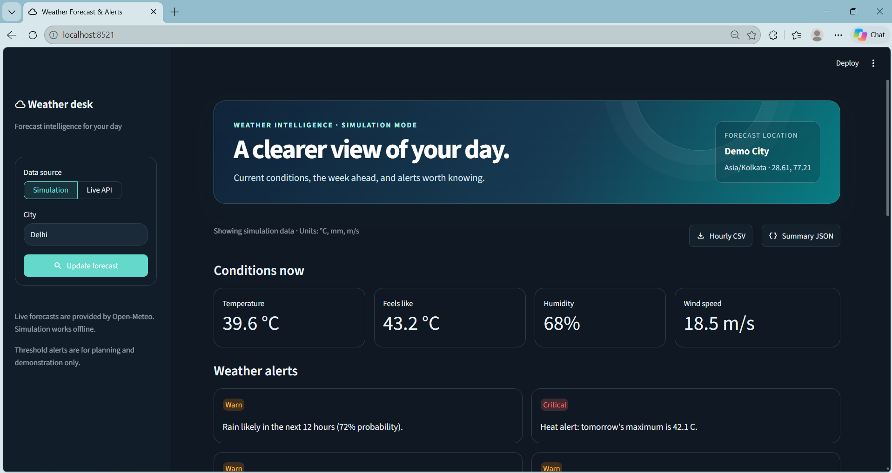

### 🚨 Weather Alerts

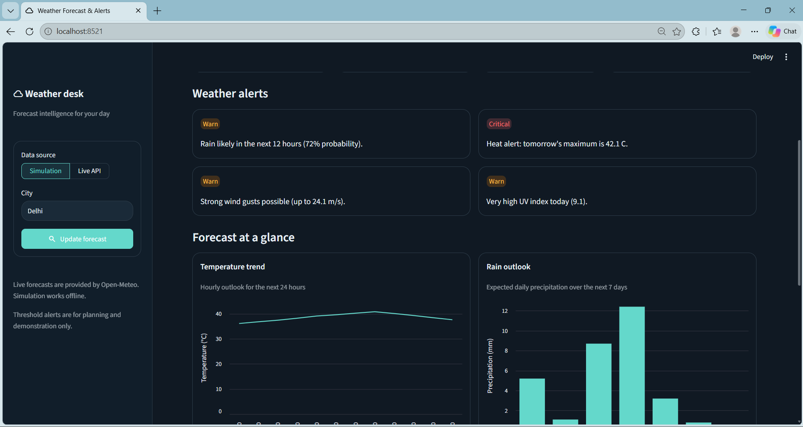

### 🌡️ Temperature Trend

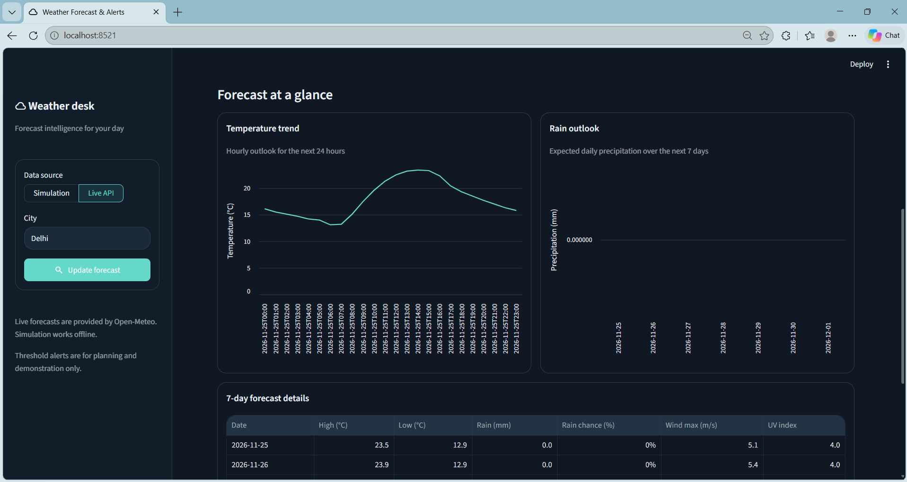

### 🌧️ Rain Outlook

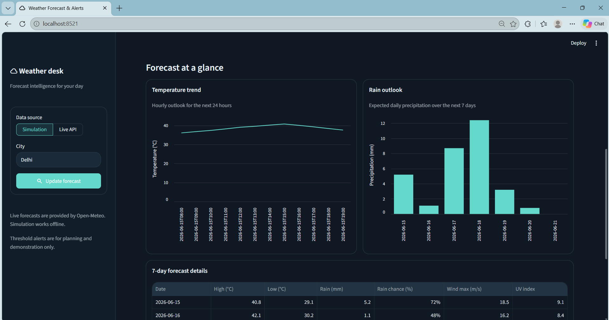

### 📅 Daily Forecast Table

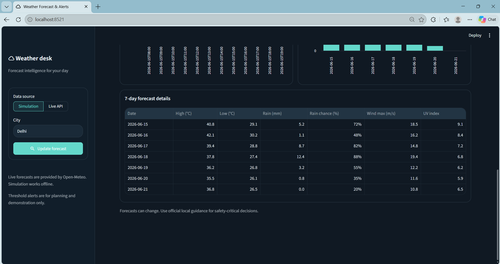

### 🌍 Live API Forecast

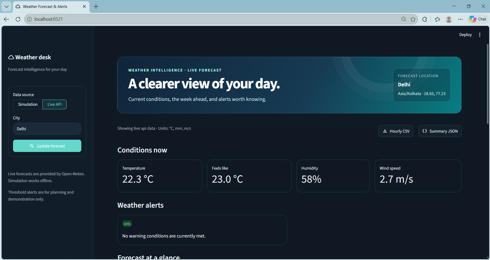

### 🖥️ Simulation Terminal Output

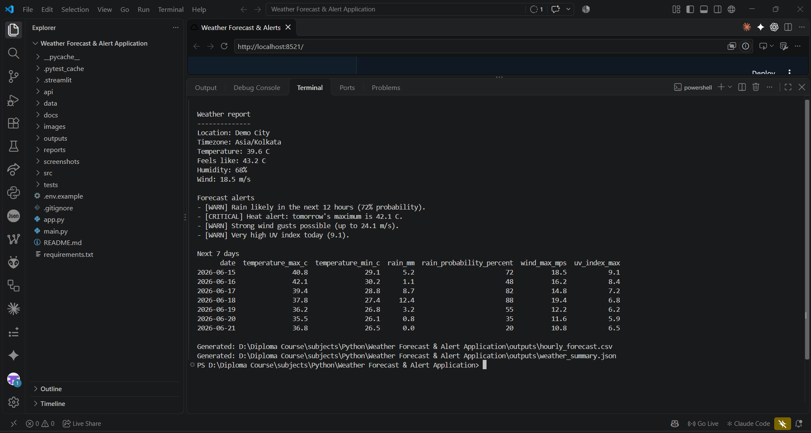

### 📄 Hourly CSV Report

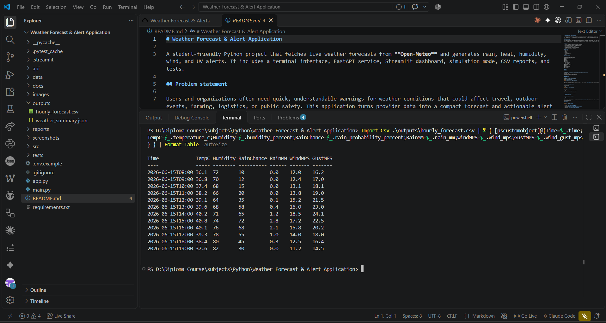

### 🧾 Weather Summary JSON

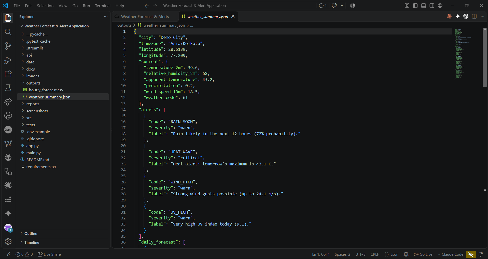

### 🔌 FastAPI Documentation

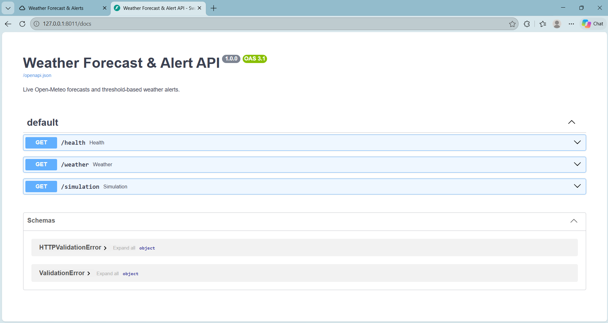

### ✅ Passing Tests

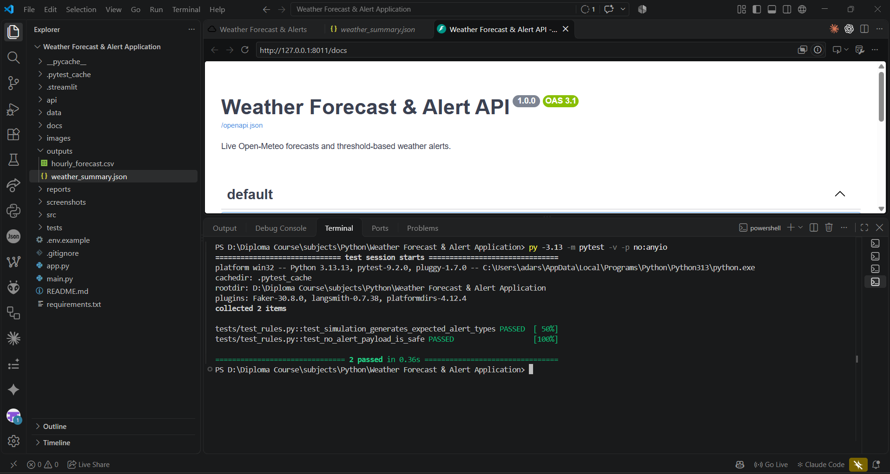

---

## 📁 Project Structure

```text
Weather-Forecast-Alert-Application/
├── .streamlit/
│   └── config.toml
├── api/
│   ├── __init__.py
│   └── app.py
├── data/
│   └── sample_weather.json
├── outputs/
│   ├── hourly_forecast.csv
│   └── weather_summary.json
├── screenshots/
│   └── project evidence
├── src/
│   ├── __init__.py
│   ├── reports.py
│   ├── rules.py
│   └── weather.py
├── tests/
│   └── test_rules.py
├── .env.example
├── .gitignore
├── app.py
├── main.py
├── README.md
└── requirements.txt
```

---

## 🛠️ Implementation Workflow

```text
Project requirements
        ↓
Choose Open-Meteo and define the weather payload
        ↓
Implement live fetch and offline simulation
        ↓
Normalize hourly and daily report data
        ↓
Implement alert thresholds
        ↓
Build CLI and report generation
        ↓
Expose FastAPI endpoints
        ↓
Build Streamlit dashboard
        ↓
Test simulation and alert behavior
        ↓
Document and publish to GitHub
```

---

## ▶️ How to Run the Project

### 1. Requirements

- Python 3.11 or newer
- Internet access for Live API mode
- No Open-Meteo API key is required for basic use

### 2. Create and activate a virtual environment

#### Windows PowerShell

```powershell
py -3 -m venv .venv
.venv\Scripts\Activate.ps1
python -m pip install -r requirements.txt
```

#### macOS/Linux

```bash
python3 -m venv .venv
source .venv/bin/activate
python -m pip install -r requirements.txt
```

### 3. Run the command-line application

Offline simulation:

```bash
python main.py --mode simulation
```

Live forecast:

```bash
python main.py --mode api --city "Delhi"
```

Reports are generated in `outputs/`:

- `hourly_forecast.csv`
- `weather_summary.json`

### 4. Run the Streamlit dashboard

```bash
python -m streamlit run app.py
```

Select **Simulation** for offline sample data or **Live API** and enter a city for a current forecast.

### 5. Run the FastAPI service

```bash
python -m uvicorn api.app:app --reload
```

Endpoints:

- API documentation: `http://127.0.0.1:8000/docs`
- Health check: `http://127.0.0.1:8000/health`
- Live weather: `http://127.0.0.1:8000/weather?city=Delhi`
- Simulation: `http://127.0.0.1:8000/simulation`

### 6. Run tests

```bash
python -m pytest -v
```

---

## 🧪 Testing

The current test suite checks the alert engine using the sample payload and a no-alert scenario.

| Test | Expected result |
|---|---|
| Simulation generates expected alert types | Passes for rain, heat, wind, and UV |
| No-alert payload is safe | Returns a single informational alert |

Latest verified result: **2 tests passed**.

---

## 📈 Results

The project demonstrates a complete local weather workflow:

- Fetch live city weather without managing a provider API key.
- Run demonstrations from local sample data without internet.
- Evaluate current and forecast values using clear threshold rules.
- Present forecasts and alerts in the CLI, dashboard, and API.
- Export the hourly forecast and summary report.

---

## 🌍 Applications

This educational prototype demonstrates concepts that can support:

- Travel and outdoor activity planning
- Event preparation
- Agricultural planning
- Logistics and delivery planning
- Facility and operations planning
- Weather-aware dashboard prototypes

It is not a replacement for official weather advisories or emergency alert services.

---

## ✅ Advantages

- Live and offline modes.
- No API key required for the included weather provider.
- Clear separation between fetching, alert rules, reports, and user interfaces.
- Reproducible sample data for demonstrations and tests.
- Multiple interfaces: CLI, REST API, and Streamlit dashboard.
- Downloadable CSV and JSON outputs.
- Suitable for extension with additional providers or rules.

---

## ⚠️ Limitations

- Alert thresholds are demonstration values, not official meteorological guidance.
- Simulation data is fixed sample data and does not change with the current date.
- Live mode requires internet access and an available Open-Meteo service.
- The application does not currently store historical forecasts in a database.
- Scheduled refresh, notification delivery, authentication, and user accounts are not implemented.
- Air quality, storm warnings, and other data sources are not currently included.
- Forecast availability and detail depend on the upstream provider.

---

## 🚀 Future Scope

Possible extensions include:

- Configurable alert thresholds in the UI.
- Multiple saved locations.
- Caching and scheduled forecast refresh.
- Database storage and historical comparisons.
- Email, Telegram, or SMS notifications with alert deduplication.
- Air-quality and additional weather data providers.
- Maps and location visualizations.
- Deployment with containerization and monitoring.
- Improved provider adapters and expanded automated tests.

---

## 🎓 Skills Demonstrated

### Python Development

- Modular application structure
- Functions, exceptions, and data processing
- JSON and CSV handling
- Unit testing

### API Integration

- HTTP requests and status checking
- Geocoding and forecast APIs
- REST endpoint design
- API response processing

### Data and Visualization

- Hourly and daily forecast tables
- CSV and JSON report generation
- Dashboard metrics and charts
- Threshold-based alert evaluation

### Application Development

- Streamlit user interface
- FastAPI service
- Command-line application
- Configuration and environment hygiene

### Tools

- Python
- Requests
- Pandas
- Streamlit
- FastAPI
- Uvicorn
- pytest
- Git and GitHub

---

## 💼 Industry Relevance

Weather conditions influence planning in transportation, agriculture, energy, tourism, event operations, and logistics. This project demonstrates practical software-development skills including third-party API integration, data transformation, rule evaluation, reporting, REST API development, UI development, and automated testing.

---

## 📚 Documentation and Outputs

- Project setup and usage: this `README.md`
- Sample weather payload: `data/sample_weather.json`
- Hourly report: `outputs/hourly_forecast.csv`
- Summary report: `outputs/weather_summary.json`
- Screenshots: `screenshots/`
- Alert rules: `src/rules.py`
- Automated tests: `tests/test_rules.py`
- API source: `api/app.py`

---

## 🔬 Project Status

### ✅ Functional Student Prototype

The current implementation supports live Open-Meteo weather, offline simulation, threshold-based alerts, report generation, a Streamlit dashboard, and FastAPI endpoints. The alert rules are covered by a small automated test suite.

> The project is for demonstration and learning. It is not an official weather warning or emergency-response system.

---

## 👨‍🎓 Author

**Adarsh Srivastav**
Computer Science and Engineering (CSE) Student

**Areas of Interest:**
Python | API Integration | Data Visualization | Application Development

---

## ⭐ Conclusion

The **Weather Forecast & Alert Application** shows how public weather data can be transformed into clear forecasts, threshold-based alerts, and downloadable reports. Its modular structure makes it possible to extend the project with additional data providers, storage, notifications, and deployment options.

```text
CITY INPUT OR SAMPLE DATA
          ↓
OPEN-METEO FETCH OR SIMULATION
          ↓
FORECAST PROCESSING
          ↓
ALERT RULES
          ↓
CLI + STREAMLIT + FASTAPI
          ↓
CSV AND JSON REPORTS
```

---

## ⭐ Project Highlights

```text
Open-Meteo Live Forecast
Offline Simulation Mode
Rain / Heat / Humidity / Wind / UV Alerts
Streamlit Dashboard
FastAPI REST Endpoints
Hourly CSV Report
Weather Summary JSON
pytest Unit Tests
Python 3.11+
GitHub Screenshot Evidence
```

**Project Status: ✅ Functional Student Prototype | 🌐 Live API + Offline Simulation | 🧪 Tests Passing | 🚀 Published on GitHub**
